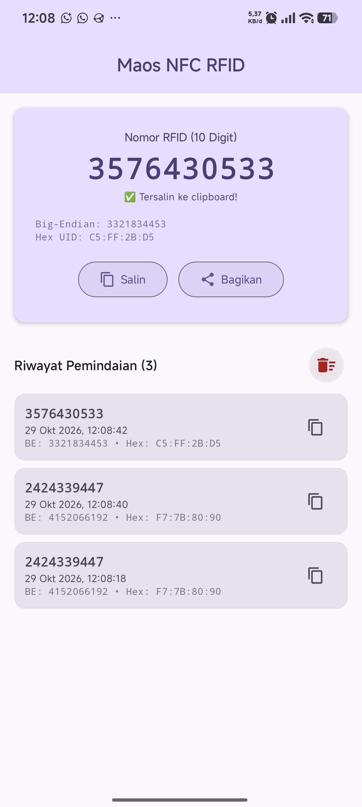

# Maos NFC RFID Android

<p align="center">
  
</p>

<p align="center">
  <a href="https://github.com/KaleksananBarqi/maos-nfc-rfid-android/releases/latest"></a>
  
  
  
</p>

Aplikasi Android utilitas untuk membaca kartu RFID santri (13.56 MHz, ISO 14443-A) menggunakan sensor NFC di smartphone, lalu mengkonversi UID kartu secara instan menjadi **angka desimal 10 digit** standar USB RFID Reader untuk pendaftaran kartu pada sistem [Pesantrenqu](https://admin.pesantrenqu.id/) tanpa perlu membawa reader fisik.

---

## ✨ Fitur Utama

- 🔢 **Konversi Instan 10 Digit** — Mengonversi 4-byte hardware UID kartu langsung ke format 10 digit desimal Little-Endian (`%010d`) sesuai dengan output scanner USB PC di web admin Pesantrenqu.
- 📋 **Auto-Copy ke Clipboard** — Begitu kartu ditempelkan di belakang ponsel, nomor 10 digit langsung otomatis tersalin ke *clipboard* tanpa perlu klik manual.
- 📳 **Haptic Feedback** — Getaran konfirmasi instan (60ms) saat pemindaian kartu berhasil.
- ⚡ **Zero-Latency Reader Mode** — Menggunakan `NfcAdapter.enableReaderMode` untuk pemindaian mulus tanpa pop-up sistem dan tanpa suara bawaan OS.
- 🔄 **Dukungan Multi-Format** — Menampilkan format utama Little-Endian, serta opsi sekunder Big-Endian dan Heksadesimal mentah (`XX:XX:XX:XX`).
- 📜 **Riwayat Lokal Persisten** — Riwayat pemindaian tersimpan secara offline di SQLite/Room database lokal lengkap dengan stempel waktu dan tombol salin ulang.
- 📤 **Bagikan Cepat** — Tombol bagikan langsung ke WhatsApp, Catatan, atau aplikasi pesan lainnya.
- 🌙 **Material 3 UI** — Antarmuka modern yang secara otomatis beradaptasi dengan Dark Mode dan Light Mode sistem.
- 📡 **Offline 100%** — Tidak memerlukan internet, otentikasi, atau login akun.

---

## 🔍 Logika Konversi

Perangkat keras USB RFID Reader di PC membaca 4 byte UID kartu (contoh UID: `F7 7B 80 90`) dan memformatnya menjadi bilangan 32-bit *unsigned integer* dalam urutan **Little-Endian**:

```
(0x90 << 24) | (0x80 << 16) | (0x7B << 8) | 0xF7 = 2424339447
```

Aplikasi ini melakukan konversi yang identik secara otomatis, sehingga hasil scan kartu santri di HP menghasilkan angka yang 100% cocok dengan pendaftaran di komputer.

---

## 📱 Persyaratan Sistem

- Android 8.0 Oreo (API 26) ke atas
- Smartphone yang memiliki sensor perangkat keras NFC
- Kartu RFID 13.56 MHz (MIFARE Classic / Ultralight / NTAG)

---

## 🚀 Unduh & Pemasangan

Unduh berkas APK versi terbaru pada halaman [Releases](https://github.com/KaleksananBarqi/maos-nfc-rfid-android/releases):

1. Unduh **`Maos-NFC-RFID-Android-v1.0.1.apk`**.
2. Pasang di ponsel Android Anda (izinkan *Install unknown apps* jika diminta).
3. Pastikan sensor **NFC** aktif di pengaturan HP.
4. Buka aplikasi dan tempelkan kartu RFID santri ke bagian belakang HP!

---

## 🛠️ Build dari Sumber

```bash
# Clone repositori
git clone https://github.com/KaleksananBarqi/maos-nfc-rfid-android.git
cd maos-nfc-rfid-android

# Jalankan pengujian unit
./gradlew testDebugUnitTest

# Build APK debug
./gradlew assembleDebug

# Build APK release siap pasang
./gradlew assembleRelease
```

---

## 📚 Dokumentasi Arsitektur

- [Glosarium Domain](GLOSSARY.md)
- [Spesifikasi Produk v1.0.0](docs/SPEC.md)
- [Spesifikasi Pembaruan v1.0.1](docs/SPEC-002-little-endian-primary.md)
- [ADR 0001: Native Compose & Konversi UID](docs/adr/0001-native-compose-and-uid-conversion.md)
- [ADR 0002: NFC Reader Mode & Room Storage](docs/adr/0002-nfc-reader-mode-and-history-storage.md)
- [ADR 0003: Standarisasi Little-Endian Primer](docs/adr/0003-little-endian-primary-format.md)

---

## 📄 Lisensi

Proyek ini dilisensikan di bawah [MIT License](LICENSE).
